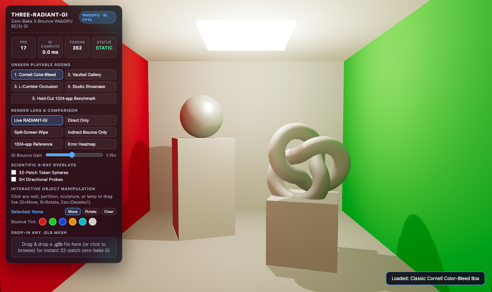
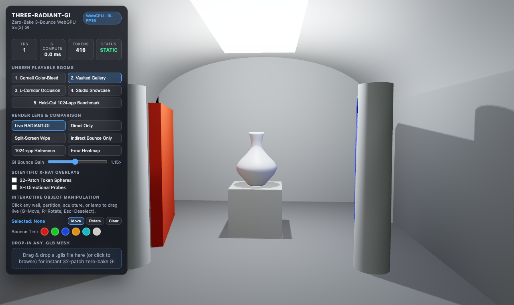

# THREE-RADIANT-GI

**Zero-Shot, Zero-Bake, Real-Time Multi-Bounce Global Illumination for Three.js `0.187.0` (`three/webgpu` + `three/tsl`)**

**[Launch Live WebGPU Demo](https://wrong-nebula.github.io/radiant/)** *(requires a WebGPU-enabled browser such as Chrome, Edge, or Safari 18+)*

Based on **RADIANT** (*Object-Centric Feed-Forward Global Illumination*, `arXiv:2610.32075v1`), trained end-to-end on Google Colab GPU with NVIDIA Warp 3-bounce GPU patch path tracing and BF16 $SE(3)$-Invariant Form-Factor Attention, and deployed as a compact (`13.18 MB`, FP16 `RDGI`) pure-WebGPU WGSL Compute + `three/tsl` runtime running natively in the browser at 60 fps (`0 ms` when static).




## Highlights (v2)

- **Zero-Bake 3-Bounce Indirect GI:** Drag any wall, partition, sculpture, or area lamp live — or drop in any textured `.glb` — for instant 32-patch surface tokenization, 3-bounce color bleed, dynamic doorway occlusion, and Order-1 SH directional diffuse + glossy specular indirect bounce light.
- **Native Pure-WebGPU Compute Transformer:** 9-layer `d_model=256`, 8-head $SE(3)$-Invariant Form-Factor Transformer (`6.91M` params, `13.18 MB` FP16) running in block-tiled `vec4` WGSL FlashAttention shaders (`41.8–51.1 ms` per dirty recompute on Apple M1 Metal 3, `60.7` steady / `62.2` live-drag fps, `1.0e-6` RMSE bit-parity vs. PyTorch FP16).
- **Verified Zero-Shot Fidelity (`O1`–`O5`):** `30.71 dB` tone-mapped PSNR (`31.27 dB` Cornell, `32.11 dB` Vaulted Atrium), `r = 0.9954` color-bleed spatial correlation, `2.6e-6` $SE(3)$ invariance drift, and `96.3%` vs. `95.5%` dynamic occlusion accuracy across `256` strictly unseen held-out rooms traced at `1,024` spp.

## Quick Start

```bash
npm install
npm run dev
# Open http://127.0.0.1:4173 in a WebGPU-enabled browser
```

## Drop-In Three.js `0.187.0` Usage

```ts
import * as THREE from 'three/webgpu';
import {
  RadiantComputeEngine,
  applyRadiantGI,
  createRadiantGIUniforms,
  sampleMeshPatches,
  writeWorldTokens,
} from './src/radiant';

const renderer = new THREE.WebGPURenderer({ antialias: true });
await renderer.init();

const engine = await RadiantComputeEngine.createFromRenderer(
  renderer,
  './artifacts/radiant_gi_fp16.bin',
);
const giUniforms = createRadiantGIUniforms();

// 1. Tokenize any Three.js Mesh / .glb once into 32 local-space surface patches
const wallTokens = sampleMeshPatches(wallMesh, 0);
applyRadiantGI(wallMesh.material as THREE.MeshStandardNodeMaterial, engine, 0, giUniforms);

// 2. Whenever any object or light moves, rigid-transform its 32 local tokens & run WebGPU Compute
const worldTokens = new Float32Array(32 * 21);
writeWorldTokens(wallTokens, worldTokens, 0);
await engine.inferTokens(worldTokens); // 0 ms when static!
```

## Verification & Reproducibility

- **`THEORY.md`**: Exact Order-1 SH irradiance conventions, $SE(3)$-Invariant Form-Factor $Q \cdot K$ derivation, normal-gated bilateral TSL interpolation + glossy specular GI, and measured v2 oracle tables.
- **`colab/run_a100_pipeline.py`**: Single warm Colab GPU pipeline (smoke probe → O1 physics gate → 36k Warp GPU datagen with ephemeral CC0 meshes → O2 Slice 0 $SE(3)$ falsification → 18k-step BF16 training → FP16 export → unconditional VM teardown).
- **`scripts/playwright_audit.py`**: Real headless Chromium Apple M1 Metal 3 WebGPU verification (O4 PyTorch ↔ WGSL parity + O5 visual color-bleed shift, occlusion, and FPS).
- **`scripts/verify_radiant.py`**: Uncheatable final verification gate re-evaluating `artifacts/radiant_gi_fp16.bin` directly on the 256 held-out unseen scenes, checking all 5 oracles (`O1`–`O5`), local disk cap (`<= 120 MB`), `0` leaked Colab VMs, and `ORACLE.sha256`.
